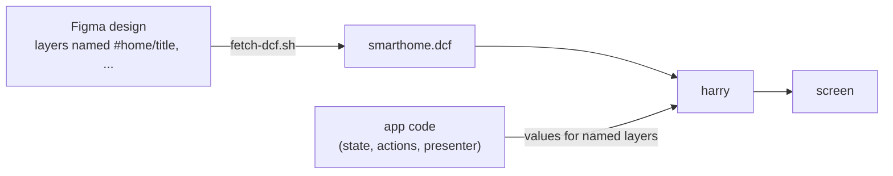
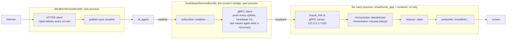
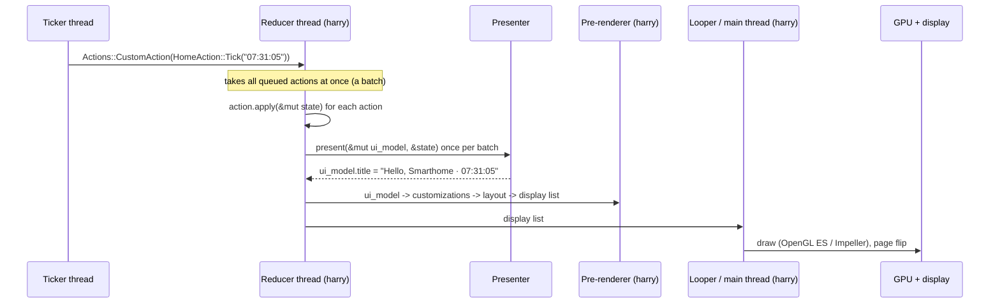
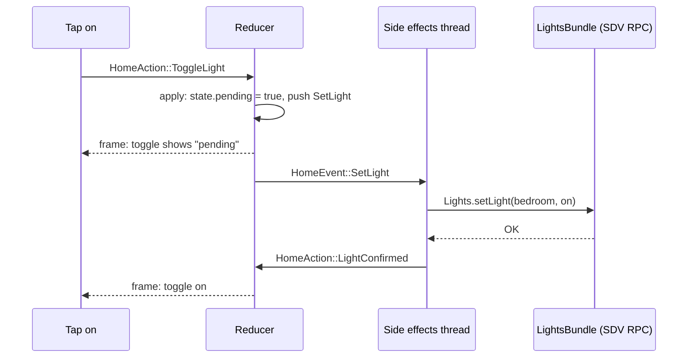

# Anatomy of a harry app

How a harry app is built, step by step, using `smarthome_app` as the example
(`packages/services/display_safety/utils/smarthome-app`). Every code snippet below is from that
app or from harry itself (`packages/services/display_safety/framework/harry/src`).

## 1. The idea in one picture

A harry app does not draw. There is no API to place, size or paint an element: the screen is a
Figma design, fetched once into a `.dcf` file, and the app only says **what changes**: "this
text now reads 07:31", "this toggle is on". harry draws the design with those changes on the
GPU.

The one way pixels come from the app is a layer that shows them: an image layer takes a frame
(`ImageContentData`, a camera), or an external GL renderer draws into a texture that harry
composes into a tagged layer (`ExternalImage`, `har_gl_context::HarExternalRenderContext`).
Even then the design decides where that layer is and how big; the app never touches the
display itself.



The link between code and design is the **layer name**. A layer called `#home/title` in Figma
and the field `#[Design(node = "#home/title")] title: String` in the app are the same thing.

### Where the logic lives: service bundles; harry is only the screen

Everything that is not the screen is a **service bundle**: the weather API, a lamp on Zigbee,
the door lock, a cloud, the state of every device. A bundle is its own process and SELinux
domain, started and restarted by the lifecycle agent
([3. Service bundles](https://github.com/sdv-everyware/everyware/blob/main/docs/concepts/3-service-bundles.md)),
and talks to the others by topics and RPC through the SDV agents. The harry process holds only
the UI: the state of the screen, the presenter, the taps. It never opens a socket of its own,
never talks to a device and never calls the internet.

The harry process is not an SDV participant either: the middleware client (`Communicate`)
exists only inside a bundle started by the lifecycle agent. So the screen has a **bridge
bundle**, `DashboardServiceBundle` (`vendor/sdv-everyware/everyware/bundles/dashboard`): it
subscribes to every topic the dashboard shows and pushes each update into the harry process
over a local gRPC connection (`bundles/dashboard/proto/dashboard.proto`, port 7100 on
127.0.0.1); the harry process only listens (`src/house_link.rs`). This is the shape of HAR's
own reference: `HarSdvServiceBundle` pushes the vehicle data into `harry-app` the same way.



| Put it in a bundle | Keep it in the harry process |
|--------------------|------------------------------|
| network, device protocols, cloud APIs, parsers | the state of the screen (which tile, which value is shown) |
| the state of the devices (a lamp is on, the door is locked) | the presenter and the UI model |
| decisions that outlive the screen (schedules, scenes) | gestures on the controls, the library components' state (pressed, open) |
| data for other screens, devices and AI agents (topics) | the local mirror of the data, as it arrived |

Two processes on each side, so a failure stays where it happens:

| A crash in | What happens | What does not happen |
|------------|--------------|----------------------|
| a device bundle (a TLS handshake, a JSON parser, a device protocol) | the lifecycle agent restarts it; the bridge keeps the last value, the screen shows it | the screen and the touch input do not stop; no frame is lost |
| the bridge bundle | restarted by the lifecycle agent; it subscribes again and the topics hand it the current values | the device bundles do not notice |
| the harry process (the renderer, the presenter, a customizer) | the process restarts and listens again; the bridge sees the heartbeat answered and sends the last values at once | the devices and their state in the bundles are untouched: a lamp that is on stays on, the weather is not fetched again |

Also: only the device bundle needs network access and the permission for it; the topic serves
every screen, every device and the AI agents
([4. Communication](https://github.com/sdv-everyware/everyware/blob/main/docs/concepts/4-communication.md));
a mock bundle publishes the same topic for a demo without a network. Verified on the RB3
(2026-11-05): the weather bundle publishes, the bridge has it 9 ms later and pushes it, the
screen shows it; `house link: up` in the app's log.

Official documentation of harry and HAR: [Display Safety: the high availability renderer (HAR)](https://source.android.com/docs/automotive/sdv/display-safety),
[Get started with Display Safety](https://source.android.com/docs/automotive/sdv/display-safety/get-started).

## 2. The parts

| Part | File in smarthome_app | What it is | Who changes it |
|------|------------------------|------------|----------------|
| Design | `data/smarthome.dcf` | the Figma file, fetched | the designer, then `fetch-dcf.sh` |
| **State** | `src/state.rs` | the app's data: plain Rust struct, no UI | only actions |
| **Action** | `src/actions.rs` | "something happened": an enum; `apply` changes the state | sent by anyone: input, timers, network, SDV |
| **Reducer** | harry (`DefaultReducer`) | the loop that applies actions, calls the presenter and renders | nobody, it is harry's |
| **Presenter** | `src/presenter.rs` | turns state into UI values | called by the reducer |
| **UI model** | `src/ui_model.rs` | one field per Figma layer the app writes | only the presenter |
| **Looper** | harry (`create_looper`) | owns the screen and the GPU, draws, delivers touches | nobody, it is harry's |
| **UI event listener** | `src/ui_event_listener.rs` | turns a tap on a layer into an action | called by the looper |
| **House link** | `src/house_link.rs` | the gRPC server the bridge bundle pushes the house's data into; every message and the heartbeat watchdog become actions | its own thread, started by `main.rs` |
| **Side effects** | (stub, `src/main.rs`) | work that is not a state change, e.g. an RPC call to a bundle; never a socket of its own (see above) | returned by actions, run on their own thread |
| Fonts | `src/resource_loader.rs` | every face the design uses | once at start |
| Wiring | `src/main.rs` | creates all of the above and starts the threads | once at start |

## 3. One frame, step by step



In harry's code the same loop reads ([`reducer.rs:60`](https://github.com/sdv-everyware/super-harry/blob/everyware-17.0.0_r1/framework/harry/src/reducer.rs#L61) `apply`, [`reducer.rs:345`](https://github.com/sdv-everyware/super-harry/blob/everyware-17.0.0_r1/framework/harry/src/reducer.rs#L400) `present`):

```rust
// for every action of the batch
action.apply(state, &mut side_effects);
// once, after the batch
PresenterType::present(&mut self.model, &self.state);
// render every display, send the frames to the looper
let (view_descriptors, update_policy) = self.render_displays(doc, ...);
self.broadcast_frame(doc, view_descriptors, &looper_tx, new_doc_available);
```

Two consequences:

- Ten actions that arrive together cost one frame, not ten.
- The reducer thread does the layout. Anything slow in `apply` or `present` delays the frame.
  Network, files and SDV calls never go there: they are side effects (section 9).

## 4. The threads

| Thread | Created by | Does |
|--------|------------|------|
| main = looper | `looper.start(looper_rx)` | owns EGL and DRM, draws display lists, hit-tests touches, calls the UI event listener |
| reducer | `reducer.execute(...)` | applies actions, presents, pre-renders (layout, display list) |
| side effects | `main.rs` (`side_effects_rx`) | runs the side effects the actions asked for |
| evdev | `EvdevService` | reads `/dev/input`, sends touches to the reducer |
| house link | `house_link::spawn` | the gRPC server (grpcio's own threads) and the heartbeat watchdog; both only send actions |
| your own | e.g. the ticker in `main.rs` | anything that produces actions: timers |

Nothing touches the state except the reducer thread. All other threads talk to it only by
sending actions into its channel. That is why there are no locks around the state.

## 5. Step by step: from an empty folder to a running app

### Step 1: the design

**Files:** [`data/smarthome.dcf`](../data/smarthome.dcf) (the fetched design), [`vendor/sdv-everyware/everyware/scripts/fetch-dcf.sh`](https://github.com/sdv-everyware/everyware/blob/main/scripts/fetch-dcf.sh) (the fetch, smarthome repo), root name in [`src/config.rs:12`](../src/config.rs#L12)

In Figma: a frame of the display size named `#smarthome-root` (1920x1080 on the RB3), and inside
it every layer the code will touch, named with `#`:

```
#smarthome-root            Frame 1920x1080
  #home/title              Text
```

Rules:

- Only layers the code touches need a `#name`; the rest can be called anything.
- Hidden layers are not fetched. A hidden layer is invisible to the code too.
- `/` groups names: `#home/...`, `#room/bedroom/...`.

Fetch:

```bash
FIGMA_TOKEN=... DCF_CHECK='#smarthome-root #home/title' ./vendor/sdv-everyware/everyware/scripts/fetch-dcf.sh packages/services/display_safety/utils/smarthome-app/data/smarthome.dcf <file key from the Figma URL>
```

The script checks that every name in `DCF_CHECK` is in the result.

### Step 2: the build file

**File:** [`Android.bp:11`](../Android.bp#L11)

`Android.bp`: a `rust_binary` with harry's libraries. It lives under
`packages/services/display_safety` because harry's app-side crates (`libharry_app_utils`, the
platform looper, evdev, `libhar_log`) are only visible there; the framework crates themselves
are visible to `//vendor` too (the UI library builds against them from `vendor/sdv-everyware`).

```
rust_binary {
    name: "smarthome_app",
    crate_root: "src/main.rs",
    srcs: ["data/*.otf"],
    rustlibs: ["libharry", "libharry_app_utils", "libharry_app_platform_specific",
               "libhar_platform_api", "libcustomizations", "libhar_user_input_evdev", ...],
    proc_macros: ["libderive_customizations", "libhar_ui_model_derive", "libclap_derive"],
}
```

The crate root needs a `//!` doc comment: the build denies missing docs.

### Step 3: the state

**File:** [`src/state.rs:15`](../src/state.rs#L15)

Plain data, no UI types, nothing about Figma:

```rust
#[derive(Debug, Default)]
pub struct State {
    /// Wall clock "HH:MM:SS", set by the ticker every second.
    pub time: String,
}
```

Keep in the state what the app **knows** (the time, the lamp is on), not how it looks (the
title text, the colour of the toggle). How it looks is the presenter's job.

### Step 4: the actions

**File:** [`src/actions.rs:20`](../src/actions.rs#L20) (the enum), [`src/actions.rs:32`](../src/actions.rs#L32) (`apply`)

An enum of everything that can happen, and `apply`, the only place where the state changes:

```rust
pub enum HomeAction {
    /// Once a second from the ticker thread in main.rs.
    Tick(String),
}

impl StateAction<State, ()> for HomeAction {
    fn apply(&self, state: &mut State, _side_effects: &mut Vec<SideEffects<()>>) {
        match self {
            HomeAction::Tick(time) => state.time = time.clone(),
        }
    }
}
```

`apply` must be fast and must not block: it runs on the reducer thread, right before the frame.
The second type parameter (`()` here) is the type of the app's side effects.

### Step 5: the UI model

**File:** [`src/ui_model.rs:50`](../src/ui_model.rs#L50) (the `ui_model!` macro), [`src/ui_model.rs:72`](../src/ui_model.rs#L72) (the fields), [`src/ui_model.rs:95`](../src/ui_model.rs#L95) (a slot)

One field per Figma layer, tied by the layer name. harry's derive macros (`DesignDocument`,
`HarUiModel`) turn the fields into customizations; the app wraps them in a small `ui_model!`
macro so a field is one line:

```rust
ui_model! {
    title: String = "#home/title";                              // a text
    wifi: DisplayState = "#wifi";                               // show, hide, gone
    talk: Slot = "#intercom/talk" ["SlotCustomizer"];           // a library component in its slot
    weather_chart: Slot = "#weather/chart" ["SlotCustomizer"];
}
// expands to
#[derive(DesignDocument, Debug, HarUiModel, NoDesignTokensOrVariables)]
#[DesignDocument(root)]
pub struct UiModel {
    customizers: UiModelCustomizers,          // generated by #[derive(DesignDocument)]
    display_map: HashMap<DisplayId, String>,  // display -> root frame name
    #[Design(node = "#home/title")] pub title: String,
    #[Design(node = "#intercom/talk", customizer = "SlotCustomizer")] pub talk: Slot,
    ...
}
```

What a field type does to its layer:

| Field type | Effect on the layer | Example |
|------------|---------------------|---------|
| `String` | replaces the text | `#climate/setpoint` |
| `bool` / `DisplayState` | shows, hides (`Gone` also removes it from the layout) | `#wifi` |
| `()` with `interactive` | makes the layer tappable, nothing else | a plain tap target |
| `Slot` with `SlotCustomizer` | a library component in the slot: harry clones the variant the app asks for and the component's parts move by meters and opacities ([8. UI components](https://github.com/sdv-everyware/everyware/blob/main/docs/concepts/8-ui-components.md)) | every control of the dashboard |
| `Option<NodePositionOverride>` | moves the layer (a translation, no layout) | the clone in a slot |
| `List<Item>` | fills a frame with clones of a template layer | a slot is one |
| `ImageContentData` / external image | puts an image or a camera frame in | the camera tile and its full view (external images: zones of camera-app) |

Sizes are not changed at runtime: a component's size is the variant's, drawn in Figma.

### Step 6: the presenter

**File:** [`src/presenter.rs:15`](../src/presenter.rs#L15)

The only place that turns state into looks. It runs after every batch of actions.

```rust
impl Presenter<State, UiModel> for UiModelPresenter {
    fn present(model: &mut UiModel, state: &State) {
        model.title = format!("Hello, Smarthome · {}", state.time);
    }
}
```

It writes every field every time. harry still builds a new frame after every batch, but its
pre-render cache compares the customizations with the previous frame and skips the expensive
passes when nothing structural changed (section 7). So the presenter never needs "if changed".

### Step 7: input

**Files:** [`src/ui_event_listener.rs:26`](../src/ui_event_listener.rs#L26) (touches -> gestures -> actions), [`src/main.rs:197`](../src/main.rs#L197) (evdev with `--touch-size`)

Touches reach the app as a node name, already hit-tested by harry against the layout. The UI
library turns the raw down/move/up events into gestures per node (`everyware_ui::Input`), so a
drag on a slider keeps following the finger outside the slider and a tap is a down and an up
on the same control:

```rust
impl UiEventListener for UiListener {
    fn handle_event(&mut self, event: UserInputEvent) -> HandleEventStatus {
        for (node, gesture) in self.input.feed(&event) {
            // node is the slot's name, e.g. "#entryway/light"; gesture is Down / Move / Up / Cancel
            let _ = self.actions.send(Actions::CustomAction(HomeAction::Gesture(node, gesture)));
        }
        HandleEventStatus::Consumed
    }
}
```

In the reducer the gesture goes to the component in the state (`state.dash.light.on(gesture)`),
which answers with an event (`Toggled(true)`) and its new look (pressed, the thumb's target).

The way of a touch:

```
/dev/input/event0 -> EvdevService (thread) -> InputDispatcherCallback -> reducer channel
  -> looper: hit test on the current layout -> UiEventListener::handle_event(node_id)
  -> everyware_ui::Input: gesture -> HomeAction::Gesture(node, gesture) -> reducer
```

On a real panel the touch reports its own units (the RB3's: 0..32767). `--touch-size 1920x1080`
makes `EvdevService::new_scaled` map them to pixels (har-user-input-evdev: touch is scaled to the display).

### Step 8: fonts, twice

**Files:** [`src/resource_loader.rs:17`](../src/resource_loader.rs#L17) (`FONTS`), [`src/resource_loader.rs:29`](../src/resource_loader.rs#L29) (renderer), [`src/main.rs:97`](../src/main.rs#L97) (layout helper)

harry draws with the renderer's fonts and **measures** text with the layout helper's fonts. Every
face the design uses must be loaded into both, under the family and weight the design names. A
face that is not in `data/` yet gets a stand-in under its name (today: Inter Regular for Inter
500, Inter Bold for 600, Inter for IBM Plex Mono); the text is then drawn and measured with the
stand-in.

```rust
pub const FONTS: &[(&str, u16, &[u8])] = &[
    ("Inter", 400, INTER_REGULAR),
    ("Inter", 500, INTER_REGULAR),
    ...
];
// renderer: RendererHelper::initialize_renderer -> renderer.load_font(...)
// layout:   layout_helper.load_font(...) before DefaultReducer::new(...)
```

Without the layout fonts every text is measured ~0 px wide and breaks into single letters. That
is what happened in the first smarthome run.

### Step 9: side effects (I/O, SDV, network)

**Files:** the house's data comes in through [`src/house_link.rs`](../src/house_link.rs) (every message from the bridge bundle is an action, `HomeAction::Weather`); the side-effects channel for RPC calls to the bundles is still a stub: [`src/main.rs:72`](../src/main.rs#L72). The pattern: an action pushes `SideEffects::Custom`, a side effects thread in main.rs runs them and sends the results back as actions.

An action that needs work outside the state does not do it in `apply`. It asks for it:

```rust
// in apply():
state.light_pending = true;
side_effects.push(SideEffects::Custom(HomeEvent::SetLight { room, on }));
```

The side effects thread receives `HomeEvent::SetLight`, makes the SDV RPC call (or the network
request), and when the answer arrives sends a new action back (`HomeAction::LightConfirmed`).
The reducer never waits.



SDV topics work the same way in the other direction: a thread subscribed to `light state`
turns every update into an action.

### Step 10: main.rs wires it together

**File:** [`src/main.rs`](../src/main.rs): logger [`:52`](../src/main.rs#L52), layout helper [`:67`](../src/main.rs#L67), reducer [`:73`](../src/main.rs#L73), looper [`:87`](../src/main.rs#L87) and [`:166`](../src/main.rs#L166), reducer thread [`:93`](../src/main.rs#L93), document [`:97`](../src/main.rs#L97), ticker [`:109`](../src/main.rs#L109), house link [`:122`](../src/main.rs#L122), evdev [`:131`](../src/main.rs#L131), start [`:147`](../src/main.rs#L147)

The order, as in `smarthome_app`:

1. logger, `log::set_max_level` (harry's traces are formatted before liblog drops them)
2. command line, display config (size, root frame name)
3. layout helper with the fonts
4. `DefaultReducer::new(state, ui_model, side_effects_tx, displays, actions channel, ...)`
5. looper (`harry_app_platform_specific::create_looper`) with the renderer fonts, and the UI event
   listener on it
6. `reducer.execute::<UiModelPresenter, _>(looper_tx, LocalDiskFigmaLoader)` starts the reducer
   thread
7. `Actions::SwapDocument("smarthome")` loads the design
8. own threads that produce actions: the ticker, the house link server (`house_link::spawn`);
   evdev for input
9. `looper.start()` on the main thread, until exit

## 6. Re-rendering without actions: UpdatePolicy

A customization can ask to be called again: `UpdatePolicy::NextFrame` (animations),
`UpdateInMillis(d)` (a blinking cursor), `Finished`. The reducer turns the request into an
internal `Actions::Refresh` at that time. A clock that only changes once a second does not need
it: one action a second is enough.

## 7. What harry does after the presenter

For completeness, what happens between the UI model and the display list (`pre_renderer/`):

| Pass | Does | Cached when |
|------|------|-------------|
| resolve | applies structural customizations (text, variants, lists, images) to a copy of the design tree | no structural change since the last frame |
| layout | flexbox layout of the tree (taffy), text measured with the layout fonts | tree and root size unchanged |
| animate | transitions between the previous and the current tree | |
| dl | display list: draw commands for the GPU | |

A change that only moves or fades a layer (position, opacity) keeps the cache; a new text or a new
list item rebuilds the tree. On the RB3 this decides between 20 fps and 60 fps (harry's
commits in this project: one tree per display, pictures kept between frames, two frames in flight).

## 8. Do we need the reducer pattern?

The question from 2026-11-03: is state / action / reducer / presenter worth it for smarthome?

What it gives:

| | |
|---|---|
| one thread owns the state | no locks; SDV threads, timers and input only send actions |
| batching | many updates (several SDV topics at once) cost one frame |
| a test without a screen | `action.apply(&mut state)` and `present(&mut model, &state)` are plain functions |
| a log of what happened | every change is an action value; log them and the session can be replayed |
| it is harry's | `DefaultReducer`, the presenter and the UI model are how harry is built; the looper, the cache and the animations sit behind them |

What it costs: four small files for every app, and one level of indirection (a tap is not handled
where it happens).

Leaving it out would mean writing our own loop around the looper (document loading, pre-render
caches, frame broadcast, refresh timers), which `DefaultReducer` already is. So: keep it. For
smarthome it fits the SDV side well: every topic update and every RPC answer becomes an action.

## 9. Checklist for a new screen element

1. Name the layer in Figma (`#room/bedroom/light`), keep it visible, fetch.
2. Add the name to `DCF_CHECK` so the fetch fails when it disappears.
3. State: the fact (`bedroom_light: bool`).
4. Action: what happens (`ToggleLight(Room)`, `LightChanged(Room, bool)`), `apply` changes the state,
   I/O goes to a side effect.
5. UI model: the field with `#[Design(node = "...")]`, `interactive` if it is tapped.
6. Presenter: state -> field.
7. UI event listener: `node_id` -> action.
8. Fonts: a new family or weight in the design goes into `FONTS`.

## 10. Traps we hit

| Symptom | Cause | Fix |
|---------|-------|-----|
| every text breaks into single letters | layout helper without fonts | load `FONTS` into the layout helper too |
| `Permission denied` at start | another DRM master (harry service restarted by init) | `run-smarthome-rb3.sh` stops it and waits for card0 |
| noise blocks on screen | UBWC scanout buffers rendered uncompressed | `setprop vendor.minigbm.debug nocompression` |
| low frame rate, one thread busy | VERBOSE logs formatted every frame | `log::set_max_level(Info)` |
| a layer does not react | hidden in Figma, renamed, or field without `interactive` | check the fetch output, add `interactive` |
| touch hits nothing | panel units instead of pixels | `--touch-size WxH` |
